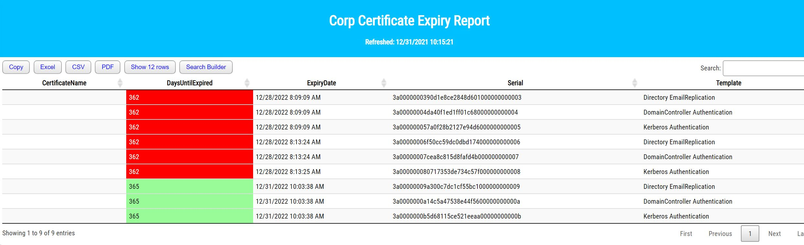
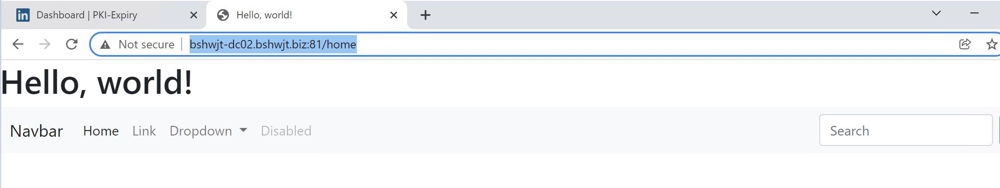
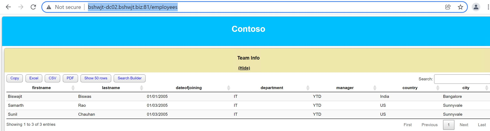
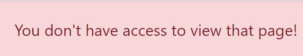
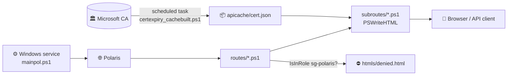
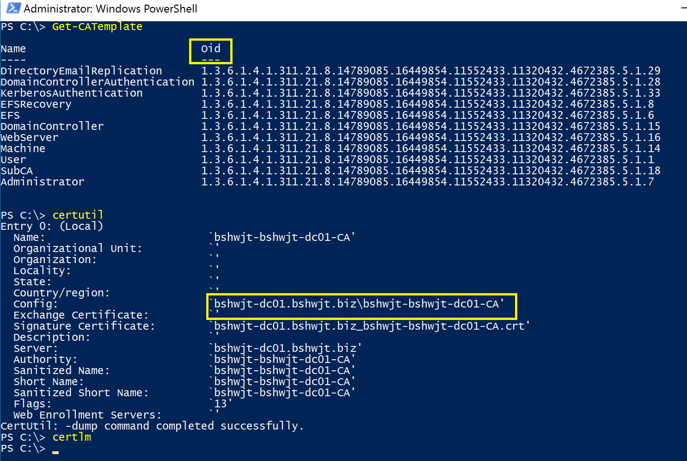
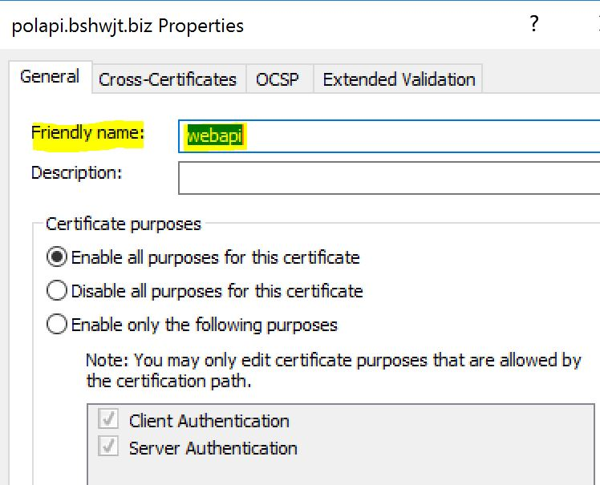

<a id="top"></a>

<div align="center">

#  PKI Polaris · Certificate Expiry Dashboard 

**Self-hosted PowerShell web API that turns your Microsoft CA into a live certificate-expiry dashboard, with zero HTML, AD-group access control and optional SSL.**

[](https://learn.microsoft.com/powershell/)
[](https://github.com/PowerShell/Polaris)
[](https://github.com/EvotecIT/PSWriteHTML)
[](https://learn.microsoft.com/windows-server/identity/ad-cs/)
[](https://learn.microsoft.com/windows-server/security/windows-authentication/windows-authentication-overview)
[](https://github.com/21bshwjt/pki-polaris/stargazers)
[](https://github.com/21bshwjt/pki-polaris/network/members)
[](https://www.linkedin.com/in/bshwjt/)

[Quick start](#quick-start) · [Screenshots](#screenshots) · [How it works](#how-it-works) · [Endpoints](#endpoints) · [Troubleshooting](#troubleshooting) · [Changelog](CHANGELOG.md)

</div>

---

<a id="toc"></a>
## 📑 Table of contents

- 💡 [Why?](#why)
- ✨ [Features](#features)
- 📸 [Screenshots](#screenshots)
- 🏗 [How it works](#how-it-works)
- 📋 [Prerequisites](#prerequisites)
- 🚀 [Quick start](#quick-start)
- 🗄 [Step 1 · Build the API cache (scheduled task)](#step-1)
- 🎨 [Step 2 · Customise the dashboard](#step-2)
- 🔐 [Step 3 · Restrict access with an AD group](#step-3)
- ▶ [Step 4 · Run as a Windows service](#step-4)
- 🔒 [Step 5 · Enable SSL (optional)](#step-5)
- 🔌 [Endpoints](#endpoints)
- 🧯 [Troubleshooting](#troubleshooting)
- 📁 [Project structure](#project-structure)
- 📝 [Changelog](#changelog)
- 🙏 [Credits](#credits)

<a id="why"></a>
## 💡 Why?

Certificate expiry is **critical**. One forgotten Domain Controller, Kerberos or RDP certificate can cause an outage. PKI Polaris gives you a dashboard that:

- reads issued certificates **straight from your Microsoft CA**,
- colours them by how soon they expire,
- is protected by an **AD security group**, and
- needs **no HTML/JS code**. [PSWriteHTML](https://github.com/EvotecIT/PSWriteHTML) builds the page for you.

[Polaris](https://github.com/PowerShell/Polaris) is a minimal, Flask-like micro-framework for building web APIs in PowerShell. Any other report (AD, DNS, Azure and so on) can be plugged in the same way.

> [!TIP]
> ⏱ Typical implementation time: **about 15 minutes**.

<a id="features"></a>
## ✨ Features

<table>
<tr>
<td width="50%" valign="top">

### 📜 Certificate expiry report
Queries the CA database for issued certificates of selected templates and shows **days until expiry**, expiry date, serial and template.

</td>
<td width="50%" valign="top">

### 🎨 Zero-HTML dashboard
PSWriteHTML gives you paging, search, CSV export, auto-refresh and **conditional formatting** (🔴 expiring / 🟢 healthy).

</td>
</tr>
<tr>
<td valign="top">

### 👥 AD group RBAC
Pages can be limited to members of an AD security group (e.g. `sg-polaris`) using Windows Integrated Authentication.

</td>
<td valign="top">

### 🔒 SSL / HTTPS
Bind a certificate from the computer store and serve the API on TCP 443.

</td>
</tr>
<tr>
<td valign="top">

### 🧾 JSON payload
`/json_payload` returns the raw certificate data as JSON for any app or OS to consume.

</td>
<td valign="top">

### ⚙ Runs as a service
Install with **nssm** as a Windows service, optionally under a **gMSA**.

</td>
</tr>
</table>

<a id="screenshots"></a>
## 📸 Screenshots

### 📜 Certificate expiry dashboard


<sub>Certificate names are blank here because these are default-published certificates without a Subject name. Certificates from your own templates will show their names.</sub>

### 🏠 Home page


### 👥 Employees page (PSWriteHTML)


### ⛔ Access denied (user not in the AD group)


<a id="how-it-works"></a>
## 🏗 How it works



| Layer | File(s) | What it does |
|---|---|---|
| 🗄 Cache builder | `build-apicache/certexpiry_cachebuilt.ps1` | Connects to the CA remotely and writes `apicache/cert.json`. Runs as a scheduled task once or twice a day. |
| 🌐 Entry point | `mainpol.ps1` | Imports Polaris, loads every route, starts the listener (port **81**) with Windows auth and writes a transcript to `C:\WebApi\Logs`. |
| 🛣 Routes | `routes/*.ps1` | Registers a `GET` path and calls its subroute (and optionally checks AD group membership). |
| 🎨 Subroutes | `subroutes/*.ps1` | Builds the HTML page (PSWriteHTML) or JSON from the cache. |
| 🔒 SSL variant | `enable_ssl/mainpol.ps1` | Same as `mainpol.ps1` but binds a certificate and listens on **443** over HTTPS. |
| ⚙ Service | `gMSA/Create_API_Svc.ps1` | Installs `mainpol.ps1` as the `corp-webapi` Windows service via nssm. |

> [!NOTE]
> `mainpol.ps1` is the **only** script that needs to run. Everything else is loaded by it at runtime.

<a id="prerequisites"></a>
## 📋 Prerequisites

| | Requirement | Notes |
|---|---|---|
| 💻 | Windows Server with PowerShell 5.1+ | Must reach the CA server. |
| 🌐 | [Polaris](https://github.com/PowerShell/Polaris) module | Web API framework. |
| 🎨 | [PSWriteHTML](https://github.com/EvotecIT/PSWriteHTML) module | Dashboard builder. |
| 🏛 | Microsoft AD CS (Enterprise CA) | The cache account needs **CA admin** rights. |
| 🔧 | [nssm](https://nssm.cc/download) | Runs Polaris as a Windows service. |
| 🧑‍💼 | [gMSA](https://learn.microsoft.com/windows-server/security/group-managed-service-accounts/getting-started-with-group-managed-service-accounts) *(optional)* | For the service and the scheduled task. |
| 👥 | AD security group *(optional)* | For RBAC, e.g. `sg-polaris`. |
| 📜 | Certificate *(optional)* | For SSL. |
| 🐙 | Git | To clone the repo. |

> [!IMPORTANT]
> The optional components are for **security**. Treat them as required in production.

<a id="quick-start"></a>
## 🚀 Quick start

```powershell
# 1️⃣ Clone and copy to C:\WebApi (paths in the scripts are hard-coded to C:\WebApi)
mkdir C:\temp; cd C:\temp
git clone https://github.com/21bshwjt/pki-polaris.git
mkdir C:\WebApi\Logs
Copy-Item C:\temp\pki-polaris\* -Recurse C:\WebApi\ -Force -Verbose

# 2️⃣ Install the modules
[Net.ServicePointManager]::SecurityProtocol = [Net.SecurityProtocolType]::Tls12
Install-PackageProvider -Name NuGet -MinimumVersion 2.8.5.201 -Force
Install-Module -Name Polaris     -AllowClobber -Force
Install-Module -Name PSWriteHTML -AllowClobber -Force

# 3️⃣ Build the cache, then start the API (test in VS Code / ISE first)
C:\WebApi\build-apicache\certexpiry_cachebuilt.ps1
C:\WebApi\mainpol.ps1

# 4️⃣ Browse to http://<server-fqdn>:81/certexpiry
```

> [!TIP]
> Get everything working interactively first, then [run it as a service](#step-4).

<a id="step-1"></a>
## 🗄 Step 1 · Build the API cache (scheduled task)

`build-apicache/certexpiry_cachebuilt.ps1` connects to the CA with the `CertificateAuthority.View` COM object and exports the matching certificates to `C:\WebApi\apicache\cert.json`.

Edit these values for your environment (see the comments in the script):

| Setting | Default in script | Change to |
|---|---|---|
| `$CAlocation` | `bshwjt-dc01.bshwjt.biz\bshwjt-bshwjt-dc01-CA` | Your `CAServer\CA-Name` |
| `$duedays` | `500` | How many days ahead to look |
| Template OIDs | RDP, Directory Email Replication, DC Authentication, Kerberos Authentication | Your template OIDs (from `Get-CATemplate` on the CA) |



Schedule it with an account (or gMSA) that has **CA admin** rights, once or twice a day.

<details>
<summary><b>🧪 Example: register the scheduled task</b></summary>
<br/>

```powershell
$action  = New-ScheduledTaskAction -Execute 'powershell.exe' `
           -Argument '-ExecutionPolicy Bypass -File C:\WebApi\build-apicache\certexpiry_cachebuilt.ps1'
$trigger = @(
    New-ScheduledTaskTrigger -Daily -At 6am
    New-ScheduledTaskTrigger -Daily -At 6pm
)
# gMSA example. For a normal service account, use -User/-Password on Register-ScheduledTask instead.
$principal = New-ScheduledTaskPrincipal -UserId 'DOMAIN\gmsa-pki$' -LogonType Password
Register-ScheduledTask -TaskName 'PKI-Polaris-Cache' -Action $action -Trigger $trigger -Principal $principal
```

</details>

> [!NOTE]
> Template names are hard-coded. Making them dynamic is possible with an advanced function.

<a id="step-2"></a>
## 🎨 Step 2 · Customise the dashboard

`subroutes/certexpiry.ps1` builds the page from the cache with PSWriteHTML:

```powershell
[void](Import-Module PSWriteHTML)
$Title      = 'Dashboard | PKI-Expiry'
$icon       = 'Your Image URL'
$headertxt  = "<h1>Corp Certificate Expiry Report</h1>"
$TableTitle = "MSFT-CA1 Expiry Report"
$data        = Get-Content "C:\WebApi\apicache\cert.json" | ConvertFrom-Json
$DbwriteTime = (Get-Item "C:\WebApi\apicache\cert.json").LastWriteTime
New-HTML -FavIcon $icon -TitleText $Title -AutoRefresh 50 {
    New-HTMLContent -HeaderText "<center>$headertxt</center><span><center>Refreshed: $DbwriteTime</center></span>" {
        New-HTMLTable -Title $TableTitle -DataTable $data -HideFooter -PagingOptions @(25, 50) {
            TableConditionalFormatting -Name 'DaysUntilExpired' -ComparisonType number -Operator le -Value 364 -Color white -BackgroundColor Red
            TableConditionalFormatting -Name 'DaysUntilExpired' -ComparisonType number -Operator ge -Value 363 -Color Black -BackgroundColor PaleGreen
        }
    }
}
```

| Knob | Where | Effect |
|---|---|---|
| 🔴 / 🟢 thresholds | `TableConditionalFormatting -Value` | Days at which rows turn red or green |
| 🔄 `-AutoRefresh 50` | `New-HTML` | Browser refresh interval (seconds) |
| 📄 `-PagingOptions` | `New-HTMLTable` | Rows per page |
| 🏷 `$Title`, `$headertxt`, `$TableTitle`, `$icon` | top of script | Branding |

<a id="step-3"></a>
## 🔐 Step 3 · Restrict access with an AD group

By default `routes/certexpiry.ps1` allows any authenticated user:

```powershell
New-PolarisGetRoute -Path "/certexpiry" -Scriptblock {
    $pkiexp = . C:\WebApi\subroutes\certexpiry.ps1
    $Response.SetContentType("text/html")
    $Response.Send($pkiexp)
}
```

To limit it to an AD security group (here `sg-polaris`), use this version of the route:

```powershell
New-PolarisGetRoute -Path "/certexpiry" -Scriptblock {
    if ( -not $Request.User.IsInRole("sg-polaris") ) {
        $Response.SetContentType('text/html')
        $Html = Get-Content C:\WebApi\htmls\denied.html -Raw
        $Response.Send($Html)
    } else {
        $pkiexp = . C:\WebApi\subroutes\certexpiry.ps1
        $Response.SetContentType("text/html")
        $Response.Send($pkiexp)
    }
}
```

Users outside the group see `htmls/denied.html`:


<a id="step-4"></a>
## ▶ Step 4 · Run as a Windows service

1. Download [nssm](https://nssm.cc/download) and extract it to `C:\nssm-2.24` (the path used by the script).
2. Run `gMSA/Create_API_Svc.ps1`. It installs and starts the **`corp-webapi`** service, which runs `powershell.exe -ExecutionPolicy Bypass -Command C:\WebApi\mainpol.ps1`.
3. *(Optional)* Set the service to log on as a gMSA with local admin rights.

> [!IMPORTANT]
> The service account and the cache account are **different** roles: the service needs local admin on the API server, and the cache account needs CA admin rights.

<a id="step-5"></a>
## 🔒 Step 5 · Enable SSL (optional)

1. Import a certificate into the API server's **Local Computer → Personal** store.
2. Give it the **Friendly name** `webapi`, or change the name on line 12 of `enable_ssl/mainpol.ps1`.

   

3. Once HTTP works, replace `C:\WebApi\mainpol.ps1` with `enable_ssl/mainpol.ps1`. It binds the certificate with `netsh http add sslcert` and listens on **TCP 443**.
4. Test from the server. The result should be `200`:

```powershell
$creds    = Get-Credential
$HostName = ($env:COMPUTERNAME + "." + $env:USERDNSDOMAIN).ToLower()
$url      = "https://$($HostName)/home"
(Invoke-WebRequest -Uri $url -Credential $creds).StatusCode
```

> [!WARNING]
> `enable_ssl/mainpol.ps1` loads only the `/home`, `/certexpiry` and `/employees` routes, and reads the IP from the interface named `Ethernet`. Add any other routes you need and check the interface alias.

<a id="endpoints"></a>
## 🔌 Endpoints

| Method | Route | Returns | Source |
|---|---|---|---|
| `GET` | `/home` | 🏠 Static HTML home page | `htmls/home.html` |
| `GET` | `/certexpiry` | 📜 Certificate expiry dashboard | `apicache/cert.json` |
| `GET` | `/employees` | 👥 Sample PSWriteHTML table | `apicache/employees.json` |
| `GET` | `/domaincontroller` | 🖥 Live list of domain controllers (name, IP, OS, site) | current AD domain |
| `GET` | `/json_payload` | 🧾 Raw certificate data as `application/json` | `apicache/cert.json` |

Default base URL: `http://<server-fqdn>:81`. With SSL: `https://<server-fqdn>`. To change the port, edit `$Port` in `mainpol.ps1`.

<details>
<summary><b>🧾 Consume the JSON payload</b></summary>
<br/>

```powershell
Invoke-RestMethod -Uri "http://<server-fqdn>:81/json_payload" -UseDefaultCredentials |
    Where-Object DaysUntilExpired -lt 30
```

```bash
curl --negotiate -u : http://<server-fqdn>:81/json_payload
```

</details>

<a id="troubleshooting"></a>
## 🧯 Troubleshooting

Logs are written to **`C:\WebApi\Logs\Polaris_<timestamp>.log`**. On startup the log lists every registered route:

```text
Path              Method
----              ------
/home             GET
/certexpiry       GET
/employees        GET
/json_payload     GET
/domaincontroller GET
```

| Symptom | Fix |
|---|---|
| ❌ Scripts fail with path errors | The repo must live in **`C:\WebApi`**. All scripts use that absolute path. |
| 📭 Dashboard is empty | Run `build-apicache/certexpiry_cachebuilt.ps1` and check `apicache/cert.json`. Check `$CAlocation`, `$duedays` and the template OIDs. |
| 🔑 Cache script returns nothing / access denied | The account needs **CA admin** rights and must reach the CA over RPC/DCOM. |
| 🏷 `CertificateName` is empty | Normal for default templates without a Subject name. |
| ⛔ Everyone gets `denied.html` | Check the group name in `IsInRole("...")`; users must sign out/in (or `klist purge`) after being added. |
| 🔁 Browser keeps prompting for credentials | Add the site to the **Local intranet** zone so Windows auth is sent automatically. |
| 🚫 Route returns 404 | Make sure the route is loaded in the `mainpol.ps1` you are running (the SSL version loads fewer routes). |
| 🔒 HTTPS fails to start | Check the certificate Friendly name, the `Ethernet` interface alias, and that nothing else is bound to port 443 (`netsh http show sslcert`). |
| 🐢 Old data shown | Confirm the scheduled task ran; the "Refreshed" time on the page is the cache file's timestamp. |
| ⚙ Service will not start | Check the nssm path (`C:\nssm-2.24\win64`) and the service account's rights. |

<a id="project-structure"></a>
## 📁 Project structure

```text
📦 pki-polaris
 ┣ 📜 mainpol.ps1                  # ▶ entry point (HTTP, port 81)
 ┣ 📂 enable_ssl
 ┃ ┗ 📜 mainpol.ps1                # 🔒 HTTPS variant (port 443)
 ┣ 📂 routes                       # 🛣 Polaris GET routes
 ┃ ┣ 📜 home.ps1
 ┃ ┣ 📜 certexpiry.ps1
 ┃ ┣ 📜 employees.ps1
 ┃ ┣ 📜 domaincontroller.ps1
 ┃ ┗ 📜 json_payload.ps1
 ┣ 📂 subroutes                    # 🎨 page / payload builders
 ┃ ┣ 📜 certexpiry.ps1
 ┃ ┣ 📜 employees.ps1
 ┃ ┣ 📜 domaincontroller.ps1
 ┃ ┗ 📜 json_payload.ps1
 ┣ 📂 build-apicache
 ┃ ┗ 📜 certexpiry_cachebuilt.ps1  # 🗄 scheduled task: CA → cert.json
 ┣ 📂 apicache                     # 📦 cached JSON data
 ┃ ┣ 📜 cert.json
 ┃ ┗ 📜 employees.json
 ┣ 📂 gMSA
 ┃ ┗ 📜 Create_API_Svc.ps1         # ⚙ nssm service installer
 ┣ 📂 htmls
 ┃ ┣ 📜 home.html
 ┃ ┗ 📜 denied.html
 ┣ 📂 Screenshots
 ┣ 📜 mermaid.md
 ┣ 📜 CHANGELOG.md
 ┗ 📜 README.md
```

<a id="changelog"></a>
## 📝 Changelog

See [CHANGELOG.md](CHANGELOG.md) for release history.

<a id="credits"></a>
## 🙏 Credits

- 📖 [Wiki](https://21bshwjt.github.io/pki-polaris/)
- 💬 The initial certificate-expiry code is based on a [TechNet forum thread](https://social.technet.microsoft.com/Forums/windowsserver/en-US/7c8ecd4f-eb2a-49f9-ae53-aad3e653d788/report-on-soon-to-be-expired-certificates?forum=winserversecurity).
- 🙌 Thanks to **Deepak Dhami**, **Siva Nallagatla**, **Prateek Singh** and **Chen V.** Special thanks to **Przemyslaw Klys**, the author of PSWriteHTML.

---

<div align="center">

Built with ❤ using **PowerShell**, **Polaris** and **PSWriteHTML**

⭐ If this saved you from an expired certificate, give the repo a star! Comments and feedback are welcome.

[](https://www.linkedin.com/in/bshwjt/)

[⬆ Back to top](#top)

</div>
